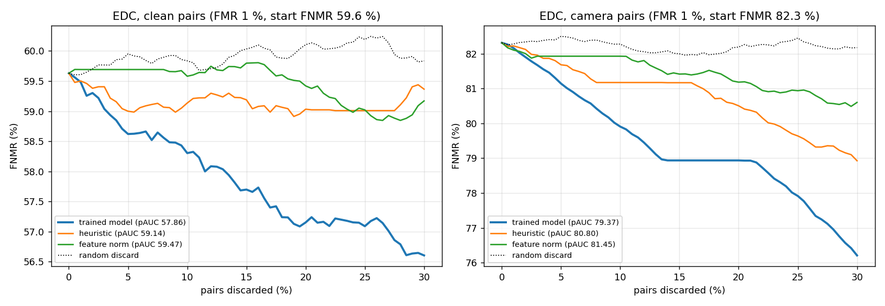
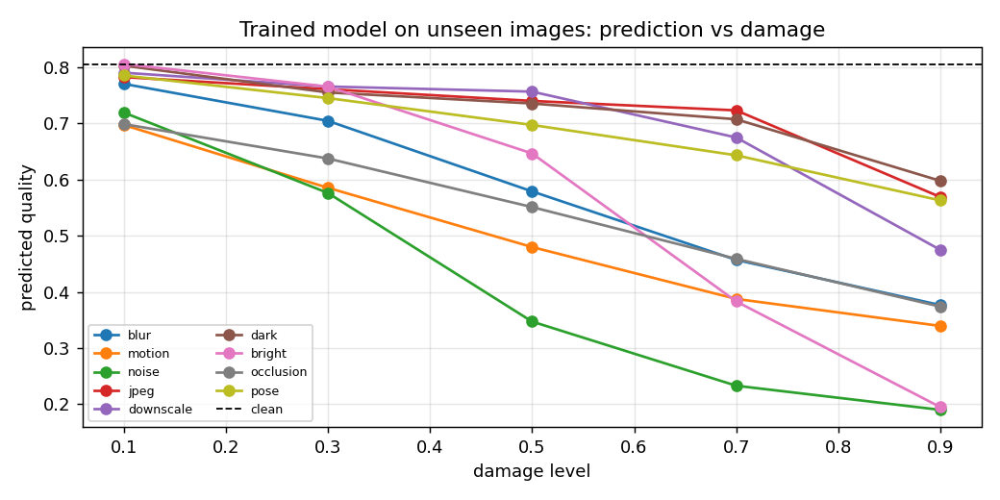

# Face quality (AI enrolment scan) — Owner: Đức Mạnh

The **Add person** page no longer asks for uploaded photos. It runs a guided face scan, either live from the phone or
webcam camera or from an uploaded video. The scan keeps the best frames for five head poses. Each frame is scored by a
**face-quality model trained here**. The score estimates how useful a frame is **to the team's own face recogniser**
(`ml/face_recognition`, v1), not how good it looks to a person.

- [x] `01_build_labels.ipynb`: labels from the recogniser (run locally)
- [x] `02_train_quality.ipynb`: MobileNetV3-Small regression (run on Colab, T4 GPU)
- [x] `03_evaluate.ipynb`: EDC curves against two baselines, damage response, threshold (run on Colab)
- [x] `infer.py` (`score`, `score_batch`, `threshold`, `info`), loaded by `backend/app/services/enrol.py`
- [x] Backend scan API (`/api/enrol/*`) and the scan UI (`frontend/src/components/FaceScan.vue`)
- [ ] Try the live scan on a phone over the LAN (`docs/LAN_DEMO.md`)

## Data and labels (notebook 01)

- Kaggle `classification_data`, the same archive and pin as `ml/face_recognition` (SHA-256 `ec28aa01…6f60`).
  The crops are 64×64 and already aligned.
- 800 identities × 10 clean crops, plus 2 damaged copies of each crop, give 24 000 crops. Train and validation are
  split **by identity** (640 / 160), so no person appears in both.
- Nine damage types at random levels: blur, motion blur, noise, JPEG, downscale, dark, bright, occlusion and pose
  (`damage.py`).
- **Label** = cosine similarity between the crop's recogniser embedding and the mean embedding of the *other* clean crops
  of the same person (leave-one-out). It is rescaled with the 1st and 99th percentiles (0.358, 0.901) and clipped to
  [0, 1]. No hand labelling is needed, and the label measures what the recogniser actually gets from the frame.
- Sanity check: clean crops average 0.77 and damaged crops 0.52. For every damage type, the label falls as the damage
  level rises (Spearman −0.43 for pose and −0.82 for bright).

## Model and training (notebook 02)

The backbone is MobileNetV3-Small (ImageNet weights, all layers fine-tuned, 1.07 M parameters) with a sigmoid
regression head. Input is 112 px RGB with ImageNet normalisation.

Training ran for 12 epochs, batch 128, one-cycle schedule, with backbone learning rate 3e-4 and head learning rate 1e-3.
The loss is Huber (δ 0.1), weight decay 1e-4, augmentation is a horizontal flip, and the seed is 30082. The best epoch
by validation Spearman was **epoch 2 (0.728)**. After that, the training loss keeps falling while the validation loss
rises, so the model starts to overfit early. The checkpoint stores the weights, preprocessing, threshold and the
recogniser version (`info()`).

## Results (notebook 03, `results.json`, `figures/`)

**EDC** (error-versus-discard characteristic): discard the lowest-quality pairs first and watch the false non-match
rate (FNMR) at a fixed 1 % false-match rate. The evaluation uses 8 805 verification pairs (`verification_pairs_val.txt`,
identities unseen in training). It runs on clean images and on a *camera-like* copy where about half the images carry
a random damage. The table gives the area under the EDC curve from 0 to 30 % discarded; lower is better.

| Score | pAUC, clean | pAUC, camera-like | Spearman with labels (val) |
| --- | --- | --- | --- |
| **Trained model** | **57.86** | **79.37** | **0.728** |
| Heuristic (sharpness + size + exposure + pose, `heuristic.py`) | 59.14 | 80.80 | 0.247 |
| Recogniser feature norm | 59.47 | 81.45 | 0.200 |
| Random discard | ≈ 59.9 | ≈ 82.3 | — |

The trained model beats both baselines on both sets. On the camera-like set, discarding the worst 30 % of pairs lowers
FNMR from 82.3 % to 76.2 %, while the heuristic only reaches 78.9 %. The gain is modest in absolute terms: the
recogniser itself is the main limit (59.6 % FNMR at 1 % FMR on these 64 px crops).

The prediction falls steadily with every damage type (`figures/damage_response.png`):

### Threshold

Notebook 03 picks the lowest threshold at which camera-like pairs with both images above it reach an FNMR no higher
than 1.1 × the clean FNMR. This gives **0.78**, stored in the checkpoint. At 0.78 the model accepts 69 % of clean crops
but only 4–9 % of blurred, motion-blurred, noisy or occluded ones (`figures/threshold.png`).

**The app uses 0.65, not 0.78** (`QUALITY_THRESHOLD_WEBCAM` in `backend/app/services/enrol.py`). Real webcam frames
from the team's AppliedML enrolment photos score lower than the Kaggle crops: the median is 0.67 for one person and
0.75 for the other. At 0.78 only 3 of 27 frames passed, so a scan would rarely finish. At 0.65, 15 of the 16 frontal
frames pass. This is a calibration on only two people, chosen by hand, and it is the main limitation below.

## How the scan uses the score

`backend/app/services/enrol.py` runs the following steps on every frame:

1. YuNet finds the face and its landmarks.
2. Head yaw and pitch come from the landmarks, and the frame is assigned a pose slot: front, left, right, up or down.
3. The frame is checked in order: liveness (anti-spoofing over the last 10 crops), brightness, face size, then quality
   ≥ threshold.
4. A frame that passes is kept, up to 3 distinct views per slot, 15 photos in total.

Each refused frame returns a hint ("move closer", "hold still", "turn left"…). The first kept photo is also checked
against the gallery, and the page warns when the person already looks registered. On registration, the photos go to
`data/photos/<student id>/` as before, with a `scan.json` that records the pose, quality, liveness and glasses of each
photo plus the model versions and the threshold used.

The quality model is given an **eye-aligned crop** (`infer.align_crop`) framed like the Kaggle training images:
eyes level, eye distance 0.189 of the side, eye midpoint at (0.50, 0.43), measured with YuNet on 400 clean training
crops. Those crops are loose (the YuNet box covers only about 42 % of the side), while the detector box with a 0.1
margin covers about 83 %, and tighter crops score lower (on 27 webcam frames, median 0.66 at margin 0 vs 0.75 at 0.3).
Switching to the aligned crop changed little in practice: median 0.712 → 0.719 on those frames, 11 % → 26 % above 0.78,
and the same 78 % above 0.65. So the framing explains only part of the gap between the Kaggle images and the webcam;
the rest needs retraining on in-domain crops.

If `face_quality.pt` is missing, the scan falls back to the heuristic at 0.35.

Smoke test (2026-11-26): a video made from Đức Mạnh's webcam photos, posted to `/api/enrol/video`, gave liveness
0.9986. It filled the front slot with quality 0.81–0.83 and the side slots with 0.72–0.78. The up and down slots
stayed empty because those photos have no such poses.

## Limits

- **Domain gap.** The model is trained on 64 px aligned Kaggle crops. Webcam and phone crops are larger and differ in
  look, hence the separate webcam threshold. The next step would be labels from the team's own recorded takes.
- **Pinned to the recogniser.** The labels come from `face_recognition` v1. If that model is retrained, run notebook 01
  again, retrain, and bump `face_quality` in `ml/model_versions.json`.
- **Clean crops are hard to rank.** The validation Spearman on clean crops alone is only 0.35; most of the signal comes
  from separating damaged frames from good ones.
- **No restoration.** Super-resolution or face restoration (GFPGAN, CodeFormer) was ruled out on purpose: it invents
  detail and moves the embedding away from the real person.
- **Video uploads.** Anti-spoofing refuses replays of a screen or a print. It cannot tell a real video of someone else
  from a video the person filmed themselves, so the live scan is the default.

## Reproduce

1. Put the Kaggle archive at `data/raw/face_quality/archive.zip` and run `01_build_labels.ipynb` locally. It writes
   `data/raw/face_quality/labels/` (`images.npy`, `labels.csv`, `meta.json`).
2. On Colab, copy `labels/` and this repo's `ml/` folder (with `face_recognition/face_recognition.pt`) to
   `MyDrive/face_quality_colab/`, then run `02_train_quality.ipynb` and `03_evaluate.ipynb`. Notebook 03 fetches the
   Kaggle archive through `kagglehub`, or copies `face_quality_colab/archive.zip` if present.
3. Copy `face_quality.pt`, `results.json` and `figures/` back here and restart the backend.
